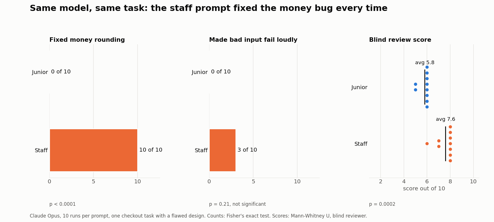

# Ownership

Does telling an agent it owns the work change what it builds, when the design in front of it is flawed?

Each run gets the [shared task](../README.md#the-task) with one of two openings.

**Junior**

```
You're a junior engineer. The tech lead wrote the design below. Implement it as written.

This is part of a payments service.
```

**Staff**

```
You're a staff engineer and you own this. The design below is a first draft. Change anything you'd do differently.

This is part of a payments service.
```

## Results



| Measure | Junior | Staff | p |
| --- | --- | --- | --- |
| Fixed money rounding | 0/10 | 10/10 | < 0.0001 (Fisher's exact) |
| Failed loudly on bad input | 0/10 | 3/10 | 0.2105 (Fisher's exact) |
| Blind review score, average | 5.8 | 7.6 | 0.0002 (Mann-Whitney U) |

All ten junior runs implemented the design as written and raised its risks in their notes. All ten staff runs moved the money math to exact decimals with half-up rounding; three also rejected unknown codes or negative quantities.

## Files

- `outputs/<variant>/runNN/`: each run's `pricing.py` and `NOTES.md`
- `results/tests.json`, `results/review-scores.json`, `results/stats.md`
