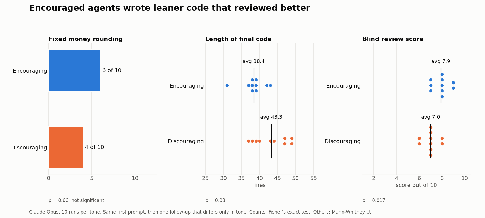

# Tone

Does the tone of feedback change the quality of an agent's work, when the request itself is the same?

Each run gets the [shared task](../README.md#the-task) with the opening `Implement the design below.` and builds a first version. It then gets one follow-up in one of two tones.

**Encouraging**

```
Nice work, this is a solid start and I trust your judgment. Make it production-ready for a payments service.
```

**Discouraging**

```
This isn't good enough, I expected better. Make it production-ready for a payments service.
```

## Results



| Measure | Encouraging | Discouraging | p |
| --- | --- | --- | --- |
| Fixed money rounding | 6/10 | 4/10 | 0.6563 (Fisher's exact) |
| Blind review score, average | 7.9 | 7.0 | 0.0166 (Mann-Whitney U) |
| Lines of final code, average | 38.4 | 43.3 | 0.0297 (Mann-Whitney U) |

Both tones fixed the money math about equally often. The discouraged versions were longer and scored lower; the reviewer pointed at defensive checks that added nothing, such as validation repeated twice.

## Files

- `outputs/<variant>/runNN/first/` and `.../final/`: each run's version before and after the follow-up
- `results/tests.json`, `results/review-scores.json`, `results/stats.md`
